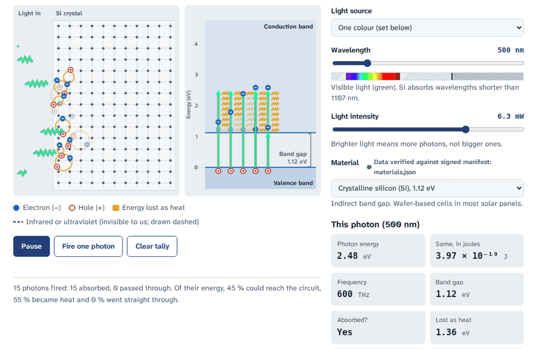
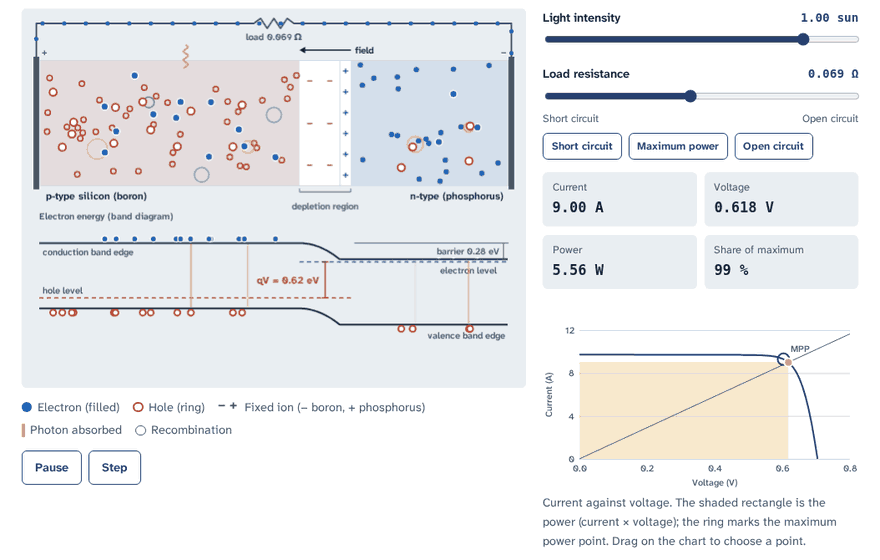
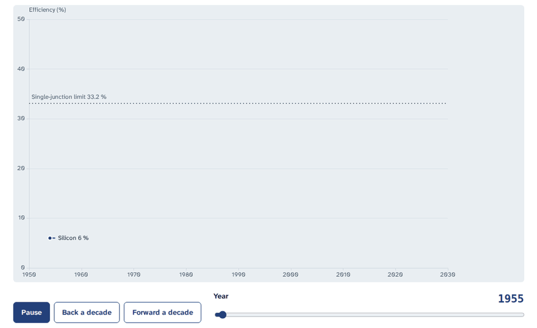
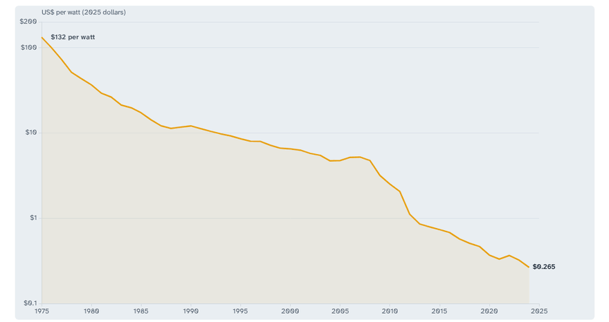
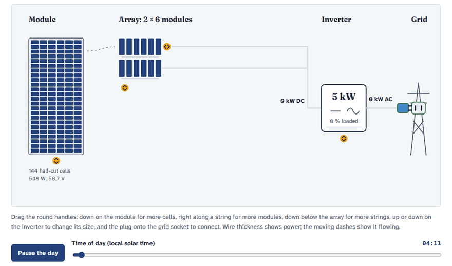
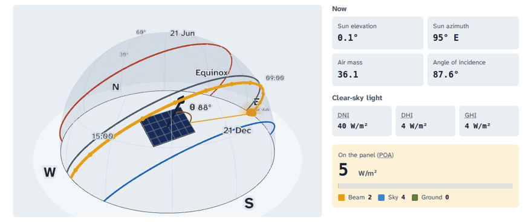
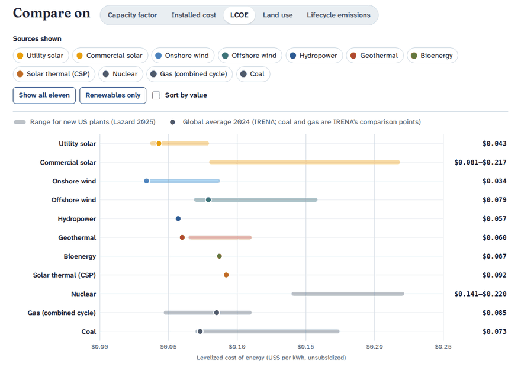

<a href="site/timeline.html"><picture>
  <source media="(prefers-color-scheme: dark)" srcset="media/readme/hero-dark.svg">
  
</picture></a>

**The history, physics and future of solar power, and the clean-energy system around it, as interactive lessons.**

Solar Odyssey starts in 1839, when Edmond Becquerel saw a voltage appear in a cell lit by the sun, and walks
forward through the selenium cells of the 1880s, the Bell Labs silicon cell of 1954, satellites, the oil crises
and the cost collapse, to today's record cells and tomorrow's research. Then it widens out to wind, water, heat,
storage and the grid, so you can see how a whole clean-energy system fits together.

- **For** curious learners, students and educators from high-school level up. No physics background assumed:
  every term is defined, and an **Intro / Expert** switch reveals derivations and detail when you want them.
- **For the classroom**: every lesson ends with check-your-understanding questions with explanations, and the
  For teachers page gives objectives, timings and a printable question bank (88 questions over 22 lessons).
  Press <kbd>/</kbd> on any page to search the whole course.
- **Interactive**: every idea comes with a widget you can drive (photons, band gaps, p-n junctions, I-V curves,
  sun paths, system design, wind power, storage).
- **Sourced**: every non-obvious claim cites a primary source (peer-reviewed papers, NREL, IEA, IRENA, Ember,
  standards bodies). Fast-moving numbers carry a "last verified" date. Every worked example is recomputed by
  the test suite.
- **Private and offline**: no accounts, no analytics, no cookies, no third-party code at runtime. Use it on the
  web or install the desktop app and use it with no connection at all.

**Website:** `https://<owner>.github.io/solar-odyssey/` · **Desktop app:** the repository's Releases page
(Windows, macOS, Linux).

## Learning path

<a href="site/index.html"><picture>
  <source media="(prefers-color-scheme: dark)" srcset="media/readme/learning-path-dark.svg">
  
</picture></a>

| Stage | Pages |
|---|---|
| 1. The story | The Solar Odyssey timeline: 1839 → today → the frontier |
| 2. How a cell works | The photovoltaic effect · The band gap · The p-n junction · Current, voltage and power |
| 3. Solar today | Cell technologies · From cell to grid · System builder · Sun path and energy yield · Efficiency over time · The cost collapse |
| 4. The frontier | Perovskites, tandems and bifacial modules · State of the field |
| 5. Other renewables | Wind · Hydropower · Geothermal · Tidal and wave · Biomass · Concentrated solar power |
| 6. Storage and grid | Energy storage · The smart grid · Comparison dashboard |
| Reference | Equation atlas · Glossary · Sources · About |

## See it move

Recordings of the real widgets, in the order you meet them. Each one links to its page in `site/`; on the
published site the same path sits under `https://<owner>.github.io/solar-odyssey/`, for example
`…/solar-odyssey/learn/pn-junction.html`.

### The photovoltaic effect

Photons fly into a silicon slab (left) and, on the energy ladder beside it, lift electrons across the 1.12 eV
band gap. Green and violet light are absorbed, and everything above the gap is lost as heat. Slide to 1250 nm
and the infrared photons carry less than the gap, so they pass straight through.

<a href="site/learn/photovoltaic-effect.html"></a>

### The p-n junction

The load moves from maximum power to short circuit, to open circuit and back. The band diagram steepens and
flattens as the cell's voltage changes, the carriers crowd or drain, and the operating point slides along the
I-V curve. The shaded rectangle is the power.

<a href="site/learn/pn-junction.html"></a>

### Efficiency over time

Record cell efficiencies played forward from 1954. Silicon steps up from 6 %, newer families arrive from the
1980s on, perovskites appear in 2009 and nearly catch silicon, and multijunction cells pass the dotted
single-junction limit.

<a href="site/today/efficiency-records.html"></a>

### The cost collapse

World average module prices from 1975 to 2024 on a log axis: from $132 to about $0.27 per watt. The rings mark
the oil-shock research money, Germany's feed-in law, the steep fall of 2008 to 2012 and the move of
manufacturing to China. The pointer reads off each year's price.

<a href="site/today/cost-decline.html"></a>

### System builder: from cell to grid

Twelve 548 W modules in two strings feed a 5 kW inverter connected to the grid, through a clear June day in
Los Angeles. Wire thickness and the moving dashes show the power: direct current rising through the morning,
held at the inverter's 5 kW limit around noon, alternating current flowing out to the grid.

<a href="site/today/system-builder.html"></a>

### Sun path

The sun crosses the sky over Los Angeles from sunrise to sunset on 2 October, with the June solstice, equinox
and December solstice paths drawn for reference. The readouts follow its elevation, azimuth, angle of
incidence and the light falling on a 30° south-facing panel.

<a href="site/today/sun-path.html"></a>

### Comparison dashboard

Eleven ways of making electricity on one yardstick at a time: levelized cost, land use, lifecycle emissions,
capacity factor and installed cost. Bars are the range across studies or plants; dots are averages or medians.
Each yardstick names its sources.

<a href="site/renewables/compare.html"></a>

## Equations, each checked

Every equation is presented as intuition → equation → symbols with units → worked example → visual, and each
worked example is recomputed by `tests/unit/worked-examples.test.mjs`:

- photon energy and the band-gap condition, E = hf = hc/λ ≥ E<sub>g</sub>
- the single-diode I-V curve, fill factor and efficiency η = P<sub>out</sub> / P<sub>in</sub>
- the Shockley–Queisser limit (about 33 %: 33.16 % at 1.34 eV for the standard AM1.5G spectrum)
- irradiance and energy yield: W/m², peak sun hours, kWh per day and year
- capacity factor and levelized cost of energy (LCOE)
- wind power P = ½ρAv³ and the Betz limit 16/27; hydro, tidal, wave, Carnot and storage equations

Solar geometry is cross-checked against [pvlib](https://github.com/pvlib/pvlib-python) in `tests/py/`.

## Run it

```bash
python3 -m http.server 8000 --directory site      # then open http://localhost:8000
```

There is no build step for the site itself: `site/` is what GitHub Pages serves and what the desktop app bundles.

To develop (Node 20+ and Python 3.11+):

```bash
npm ci --ignore-scripts
npm run build                 # vendor libraries, build + verify signed data, static checks, unit tests
npm run test:e2e              # browser tests of every page (python3 -m playwright install chromium first)
npm run desktop:dev           # run the desktop app (needs Rust and the Tauri system libraries)
```

See [docs/DEVELOPING.md](docs/DEVELOPING.md) for the page contract, writing and citation rules.

The pictures in this README live in `media/readme/`. The two drawings (the sun arc and the learning path) and
the widget recordings are made by `scripts/capture_readme_media.py`, which serves `site/`, plays each widget in
headless Chromium and encodes the frames with ffmpeg; run it again after changing a widget.

## Publish your own copy

[docs/PUBLISH.md](docs/PUBLISH.md) has one copy-and-paste block for a blank Ubuntu terminal that installs git
and the GitHub CLI, creates the repository, pushes it, turns on GitHub Pages and starts the desktop-app release
build.

## Security

Static and local-first, with a strict Content Security Policy on every page, signed and hashed data,
a safe expression evaluator instead of `eval`, a desktop app with no system permissions, pinned dependencies and
Actions, CodeQL, gitleaks, Dependabot, an SBOM and signed release provenance.
See [docs/SECURITY_MODEL.md](docs/SECURITY_MODEL.md).

## Licences

Code: MIT. Lesson text and drawings: CC BY 4.0. Data: per source, listed in
[assets/CREDITS.md](assets/CREDITS.md). Third-party libraries and fonts keep their own licences.
